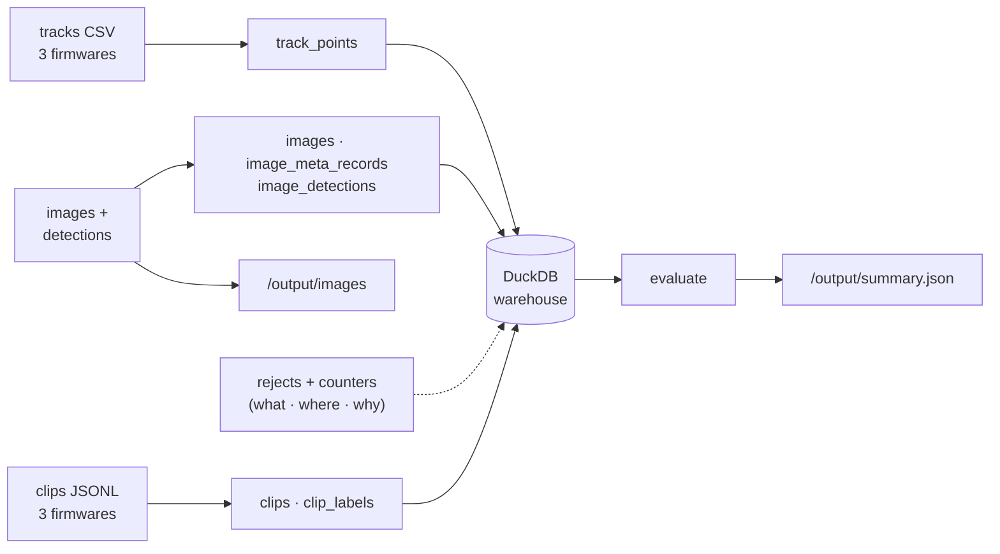

# 🌊 Harbour Watch — Data Pipeline

A year of messy sensor dumps — **tracks · image detections · clip metadata**, each delivered in **3 firmware dialects** — turned into a clean DuckDB warehouse you can trust and query, with a single command.

## ▶️ Run it

```bash
DATA_DIR=/path/to/dataset OUTPUT_DIR=/path/to/output \
    docker compose up --build --exit-code-from evaluate
```

`/data` is mounted read-only; results land in `/output` (`summary.json`, `images/`, the warehouse). No manual steps, no internet needed at run time.

## 🏗️ How it flows



Two services: **`pipeline`** reads `/data`, *normalises* the three dialects into one shape, applies the six data rules, and loads the warehouse (and copies valid images). **`evaluate`** then queries the warehouse and writes `summary.json`. DuckDB is embedded — a file, not a server — so there's **nothing to wait for on startup and fewer moving parts to break**.

## 🗄️ The schema (and why it looks like this)

The core idea: **flatten everything on ingest**. The 3 firmware dialects of each source collapse into one uniform set of tables, so *any station, any day, any firmware is queried the same way*. Every table carries `station_id` + `source_file`, so results stay sliceable and auditable.

| Table | Holds |
|-------|-------|
| `track_points` | valid positions — UTC time, **MSL** altitude, deduplicated |
| `clips` · `clip_labels` | clip metadata + per-label validity |
| `images` · `image_meta_records` · `image_detections` | image validity, detection records, per-detection validity |
| `rejects` | **everything dropped** — source, location, reason |
| `counters` | totals, so `rows_read = duplicates + rejected + valid` can be asserted |

## 🧭 Decisions worth knowing

- **DuckDB over Postgres** — a one-shot batch ending in a file; embedded means no server, no startup race, fast columnar aggregations.
- **Timestamp unit by magnitude, not the header** — one firmware writes **milliseconds under a "seconds" header** (read literally → the year 57297). s/ms/µs never overlap, so magnitude is reliable.
- **Altitude → MSL** by column name: `alt`/`alt_m` are above-ground (+ station elevation), `alt_msl` already MSL; missing stays **NULL**, never 0.
- **`track_id` stored as delivered** — unique *within* a station (fact 3), matching the forms in `sample_tracks.csv`.
- **Boxes are `[x,y,w,h]` top-left**; a detection partially outside its image is valid, entirely outside is rejected.
- **Speed/time/dedup** follow facts 1, 2, 6; UTC conversion happens *before* the 2025 filter so year-boundary readings are judged correctly.
- **Built to scale** — rows are bulk-loaded (not row-by-row: 150 s → 0.4 s) and the speed filter streams **one track at a time**, so RAM stays flat on the full 1M-file dataset.

## 🚧 What I didn't handle (and would do next)

- **Dedup is tracks-only** — fact 6 is track-specific; images/detections/clips were verified duplicate-free in the sample. Extend it if the full dataset resends those too.
- **Image validation is sequential I/O** (~90% of the 1M files) — parallelise across a worker pool; it's slow, never broken.
- **Clip-label validity is temporal only** — the pixel-box firmwares give no frame dimensions, so a spatial check isn't possible yet.
